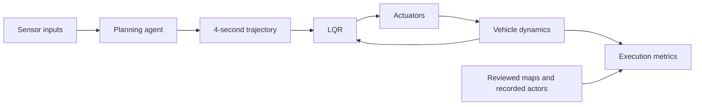

<div align="center">
<h1>ExtremeDrive</h1>
<h3>A Planning and Vehicle-Execution Benchmark for Critical Driving</h3>
<p><a href="https://huggingface.co/datasets/Stary108/Extreme_Driving_Conditions_Dataset">Dataset</a> · <a href="docs/install.md">Installation</a> · <a href="docs/agents.md">Agents</a> · <a href="docs/PROTOCOL.md">Metrics</a> · <a href="README_zh.md">中文</a></p>
</div>

ExtremeDrive evaluates planned motion under shared road, traffic and vehicle constraints. A four-second trajectory is tracked by LQR, translated into actuator commands, executed through a seven-DOF vehicle model, and evaluated against reviewed road and actor annotations.



## Highlights

- **Execution-aware evaluation:** collision avoidance, road and marking compliance, TTC, progress, comfort and short-horizon emergency safety.
- **Versioned benchmark:** unchanged 758/89/341 planning-window split; 131 test windows in the execution cohort; seven archived reference planners.
- **Compact annotations:** shared geometry and lossless LZMA storage, 5.1 MiB for all execution contexts. Original coordinates, observations and timing are preserved.
- **Portable integration:** a Python agent interface, JSONL submissions, pinned Hugging Face downloads, CPU evaluation and offline HTML/CSV/BEV outputs.

## Getting started

1. [Installation and smoke test](docs/install.md)
2. [Dataset download and data root](docs/dataset.md)
3. [Dataset API and cache format](docs/DATA_FORMAT.md)
4. [Fixed splits and evaluation scope](docs/splits.md)
5. [Implementing planning agents](docs/agents.md)
6. [Submissions and evaluation](docs/submission.md)
7. [Scoring protocol and vehicle execution](docs/PROTOCOL.md)
8. [Results and visualization tutorial](tutorials/quickstart.ipynb)
9. [Tests and reproduction evidence](docs/VALIDATION.md)

### Quick start

Run from the repository root:

```bash
python -m venv .venv
source .venv/bin/activate
pip install -e .
extremedrive --assets assets verify
bash scripts/evaluation/run_smoke.sh
```

The smoke test runs three real stored predictions through the controller and vehicle model. No sensor download or GPU is needed. Open `results/smoke/index.html` to view the results.

### Connect your planner

```bash
extremedrive --assets assets predict --agent my_agent:Agent \
  --dataroot /path/to/data --execution-only --out predictions.jsonl
extremedrive --assets assets validate --submission predictions.jsonl
extremedrive --assets assets evaluate --submission predictions.jsonl --workers 4 --out results/my_agent
```

Predictions contain eight `[x, y, yaw]` poses at 0.5–4.0 seconds in the capture-anchor ego frame. The evaluator requires the complete execution cohort unless a diagnostic subset is explicitly requested.

## Repository layout

```text
extremebench/
  agents/          # public agent interface and input-only baseline
  toolkit/         # dataset API, downloads, submissions, evaluation, visualization
  execution/       # LQR integration, actuators, vehicle dynamics
  benchmark*/      # frozen geometry and scoring implementation
  _vendor/         # attributed, pinned LQR dependency closure
assets/            # fixed splits, compact annotations, protocol, reference results
scripts/           # download, evaluation and release entry points
tutorials/         # executable dataset/evaluation walkthrough
tests/             # interface, integrity and regression checks
docs/              # installation, data, agents, splits, metrics, submissions
.github/           # CI, release artifacts and issue templates
```

## Reference results

The release contains predictions and reviewed results for Latent TransFuser, TCP, TransFuser, DiffusionDrive, PlanTF, PLUTO and Diffusion-Planner. AutoVLA is excluded.

```bash
extremedrive --assets assets reference --model pluto --out results/reference_pluto
```

Reference mode verifies archived prediction/result identities and aggregates the reviewed records. Fresh execution is reported separately and does not inherit trajectory-specific human review decisions. See [evaluation scope](docs/submission.md).

## Release history

- **0.5.0:** Git repository layout, documented agent API, workflows, tutorials and reproducible source archives. Benchmark assets and scoring rules remain unchanged.
- **0.4.1:** lossless shared-geometry compression; all 131 contexts verified against the previous release.
- **0.4.0:** standalone dataset and vehicle-execution toolkit.

See [CHANGELOG](CHANGELOG.md), [contribution guide](CONTRIBUTING.md) and [release guide](docs/releasing.md).

## Attribution and licensing

Original data: [Extreme Driving Conditions Dataset](https://huggingface.co/datasets/Stary108/Extreme_Driving_Conditions_Dataset), curated by Shiyue Zhao and the Tsinghua University Intelligent Chassis Team (CC BY-NC 4.0).

Repository organization follows [NAVSIM](https://github.com/autonomousvision/navsim) and [nuScenes devkit](https://github.com/nutonomy/nuscenes-devkit). The pinned LQR implementation and nuPlan data structures retain their source notices. ExtremeDrive uses its own annotations, vehicle configuration and scoring protocol.

See [LICENSE](LICENSE) and [THIRD_PARTY_NOTICES](THIRD_PARTY_NOTICES.md). Dataset and third-party licenses are separate from project-specific code and annotations. Paper citation metadata will be added when finalized; no publication or leaderboard affiliation is implied.
