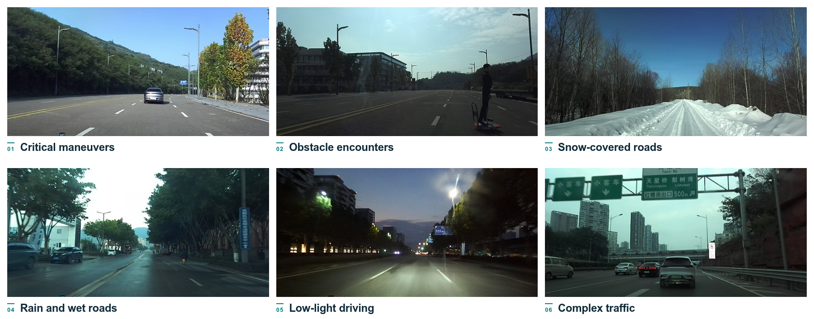
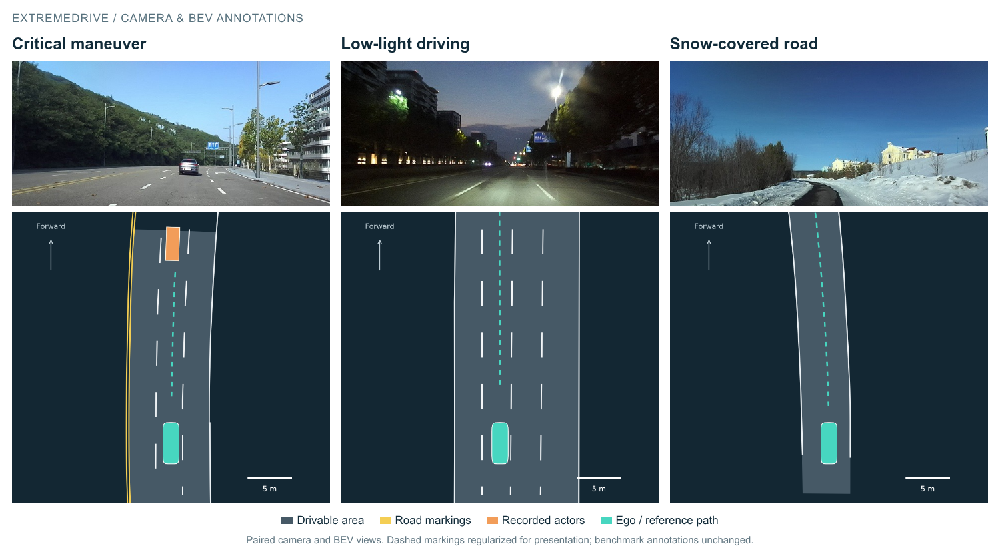

<div align="center">
<h1>&nbsp; ExtremeDrive</h1>
<h3>A Planning and Vehicle-Execution Benchmark for Critical Driving</h3>
<p><a href="https://huggingface.co/datasets/Stary108/Extreme_Driving_Conditions_Dataset">Dataset</a> · <a href="docs/install.md">Installation</a> · <a href="docs/agents.md">Agents</a> · <a href="docs/PROTOCOL.md">Metrics</a> · <a href="README_zh.md">中文</a></p>
</div>



ExtremeDrive is a dataset and benchmark for autonomous driving in critical and adverse conditions. It combines real-world driving records with road and traffic-participant annotations to evaluate motion planning under environmental and vehicle-dynamics constraints.

This toolkit provides data access, planning-agent interfaces, trajectory execution, evaluation metrics and visualization. Submitted trajectories are evaluated through a common controller and vehicle model, supporting reproducible comparisons of planning performance and executed driving behavior.




## Benchmark

The toolkit contains one evaluation implementation in `extremebench/benchmark/`. The `evaluate` command uses the current protocol and annotation snapshot.

- **Driving scenarios:** critical maneuvers and adverse weather or lighting conditions, with routine driving represented in the planning dataset.
- **Scene annotations:** road markings, drivable areas and dynamic traffic participants, aligned with vehicle motion.
- **Planning evaluation:** trajectory accuracy and execution-based measures of collision avoidance, road compliance, time-to-collision, progress and comfort.
- **Reproducible comparison:** predefined data splits, a common trajectory-execution protocol and reference results for seven adapted planning methods.

The planning split contains 758 training, 89 validation and 341 test windows. Execution-based evaluation uses a predefined subset of 131 test windows. See [data splits](docs/splits.md) and [evaluation protocol](docs/PROTOCOL.md).

## Getting started

1. [Installation](docs/install.md)
2. [Dataset download and data root](docs/dataset.md)
3. [Dataset API and cache format](docs/DATA_FORMAT.md)
4. [Fixed splits and evaluation scope](docs/splits.md)
5. [Implementing planning agents](docs/agents.md)
6. [Submissions and evaluation](docs/submission.md)
7. [Scoring protocol and vehicle execution](docs/PROTOCOL.md)
8. [Results and visualization tutorial](tutorials/quickstart.ipynb)
9. [Validation and reproducibility](docs/VALIDATION.md)

### Quick start

Run from the repository root:

```bash
conda env create -f environment.yml
conda activate extremedrive
extremedrive --assets assets verify
bash scripts/evaluation/run_smoke.sh
```

The example evaluates three supplied trajectories on CPU using the bundled scene annotations. Open `results/smoke/index.html` to inspect the results.

### Connect your planner

```bash
extremedrive --assets assets predict --agent my_agent:Agent \
  --dataroot /path/to/data --execution-only --out predictions.jsonl
extremedrive --assets assets validate --submission predictions.jsonl
extremedrive --assets assets evaluate --submission predictions.jsonl --workers 4 --out results/my_agent
```

Predictions contain `[x, y, yaw]` poses over four seconds: eight poses at 2 Hz or sixteen at 4 Hz, in the capture-anchor ego frame. The evaluator requires the complete execution cohort unless a diagnostic subset is explicitly requested.

## Sampling rates

Use `--input-hz 2|4` for causal history sampling and `--trajectory-hz 2|4` for trajectory output. Both default to 2 Hz. The data split, anchor windows, execution model and metric sampling remain fixed. See [sampling and timestamps](docs/sampling.md).

```bash
extremedrive --assets assets predict --agent my_agent:Agent \
  --dataroot /path/to/data --input-hz 4 --trajectory-hz 4 --execution-only --out predictions_4hz.jsonl
extremedrive --assets assets evaluate --submission predictions_4hz.jsonl --trajectory-hz 4 --out results/model_4hz
```

## Repository layout

```text
extremebench/
  agents/          # public agent interface and input-only baseline
  toolkit/         # dataset API, downloads, submissions, evaluation, visualization
  execution/       # LQR integration, actuators, vehicle dynamics
  benchmark/       # current geometry, road, comfort and safety metrics
  _vendor/         # attributed, pinned LQR dependency closure
assets/            # fixed splits, compact annotations, protocol, reference results
scripts/           # download, evaluation and release entry points
tutorials/         # executable dataset/evaluation walkthrough
tests/             # interface, integrity and regression checks
docs/              # installation, data, agents, splits, metrics, submissions
.github/           # CI, release artifacts and issue templates
```

## Reference results

Reference predictions and evaluation results are provided for seven adapted methods: Latent TransFuser, TCP, TransFuser, DiffusionDrive, PlanTF, PLUTO and Diffusion-Planner.

```bash
extremedrive --assets assets reference --model pluto --out results/reference_pluto
```

Use `reference` to export the supplied reference results and `evaluate` to score new trajectory submissions. Result provenance and review policies are described in the [evaluation guide](docs/submission.md).

## Development

See the [contribution guide](CONTRIBUTING.md) and [release guide](docs/releasing.md).

## Dataset

Original data: [Extreme Driving Conditions Dataset](https://huggingface.co/datasets/Stary108/Extreme_Driving_Conditions_Dataset), curated by Shiyue Zhao and the Tsinghua University Intelligent Chassis Team (CC BY-NC 4.0).
