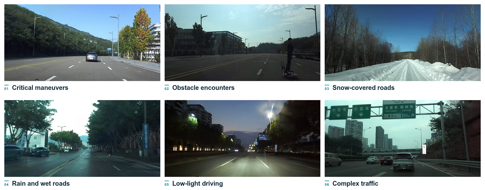
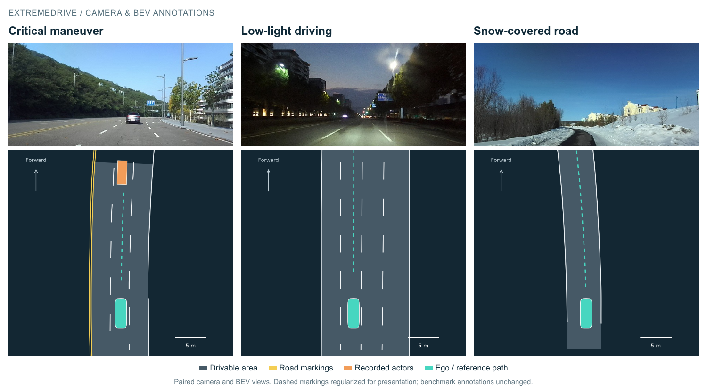

<div align="center">
<h1>&nbsp; ExtremeDrive</h1>
<h3>面向危急驾驶的真实道路数据集与评测基准</h3>
<p><a href="https://huggingface.co/datasets/Stary108/Extreme_Driving_Conditions_Dataset">数据集</a> · <a href="docs/QUICKSTART_ZH.md">使用说明</a> · <a href="docs/agents.md">模型接口</a> · <a href="docs/PROTOCOL.md">评价指标</a> · <a href="README.md">English</a></p>
</div>



ExtremeDrive 面向危急驾驶及恶劣条件下的自动驾驶研究，将真实道路驾驶记录与道路结构、交通参与者标注相结合，评价环境约束和车辆动力学约束下的运动规划能力。

本工具库提供数据访问、规划模型接入、轨迹执行、指标计算及结果可视化功能。模型提交的轨迹通过统一控制器与车辆模型执行，用于比较规划结果及其对应的车辆行为。




## 基准概览

工具库统一使用 `extremebench/benchmark/` 中的评测实现，`evaluate` 命令加载当前协议及标注。

- **驾驶场景：** 覆盖危急操作及恶劣天气、光照条件，规划数据同时包含常规驾驶。
- **场景标注：** 提供与车辆运动对齐的道路标线、可行驶区域和动态交通参与者信息。
- **规划评价：** 支持轨迹误差，以及执行后的碰撞规避、道路合规、碰撞时间、行驶进度和舒适性评价。
- **方法比较：** 使用预定义数据划分与统一轨迹执行协议。

数据组织与评测设置详见[数据划分](docs/splits.md)与[评价协议](docs/PROTOCOL.md)。

## 快速开始

```bash
conda env create -f environment.yml
conda activate extremedrive
extremedrive --assets assets verify
bash scripts/evaluation/run_smoke.sh
```

示例使用随库提供的场景标注，在 CPU 上评测三条轨迹。打开 `results/smoke/index.html` 查看结果。

## 使用文档

1. [安装与使用](docs/QUICKSTART_ZH.md)
2. [数据下载](docs/dataset.md)
3. [数据格式与接口](docs/DATA_FORMAT.md)
4. [数据划分](docs/splits.md)
5. [规划模型接入](docs/agents.md)
6. [预测提交与评测](docs/submission.md)
7. [评价指标](docs/PROTOCOL.md)
8. [交互教程](tutorials/quickstart.ipynb)

默认模型输入不包含场景标注中的避险动作提示；正式比较对所有模型采用统一自动评分。详见[输入与提示对照](docs/input_policy.md)、[舒适性配置](docs/comfort.md)和[提交规范](docs/submission.md)。

## 采样频率

提供 **2 Hz / 4 Hz** 两种配置：`--input-hz` 控制历史输入采样，`--trajectory-hz` 控制预测轨迹频率，默认均为 2 Hz。4 秒预测分别对应 8 / 16 个点；原场景归属、自车控制和指标计算时钟保持一致。详见[采样与时间戳](docs/sampling.md)。

```bash
extremedrive --assets assets predict --agent my_agent:Agent \
  --dataroot /path/to/data --input-hz 4 --trajectory-hz 4 --execution-only --out predictions_4hz.jsonl
extremedrive --assets assets evaluate --submission predictions_4hz.jsonl --trajectory-hz 4 --out results/model_4hz
```


## 开发与维护

```bash
conda activate extremedrive
python -m pip install -e '.[dev]'
python -m unittest discover -s tests -v
python scripts/dev/build_release.py
```

参见[贡献指南](CONTRIBUTING.md)和[发布说明](docs/releasing.md)。

## 数据来源

原始数据由 Shiyue Zhao 与清华大学智能底盘团队整理，托管于 [Hugging Face](https://huggingface.co/datasets/Stary108/Extreme_Driving_Conditions_Dataset)，采用 CC BY-NC 4.0 许可。

道路合规率统一评价白线与黄线、可行驶面以及墙体和隔离带等不可行区域。片段须同时满足适用的道路约束才算通过；压线容忍仍为 0 cm，行驶方向单独评价。
